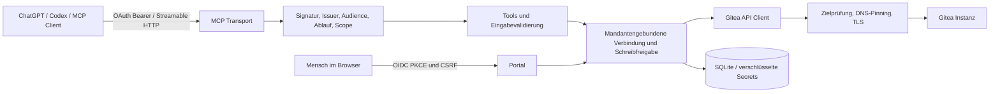

# Architektur

## Modulgrenzen

- `auth/identity.ts`: OAuth-Resource-Tokenprüfung, keine Gitea-Tokenweitergabe.
- `auth/portal.ts`: Browserlogin, PKCE/State, Einrichtung und konkrete Schreibfreigabe.
- `security/store.ts`: verschlüsselte Mandantenspeicherung, atomare Freigabeverwendung, Audit.
- `security/network.ts`: erlaubte Basis-URLs, DNS-Adressprüfung, TLS-Socket-Pinning, Grenzen.
- `security/public-server.ts`: ausschließlich öffentliche HTTPS-Ziele auf Port 443 für benutzergebundene Selbsteinrichtung; keine Übernahme privater Betreiber-CIDRs.
- `gitea/client.ts`: ausschließlich definierte API-Anfragen, sichere Fehler, Pagination und Branchschutz.
- `tools/catalog.ts`: einzeln beschriebene Zod-Schemas und typisierte Anfragebeschreibungen.
- `tools/service.ts`: Autorisierung je Ausführung, Tokenrotation und Freigabeorchestrierung.
- `mcp/server.ts`: MCP-Metadaten, Schemas, Annotations und sichere Fehlerresultate; Beschreibungen der Schreibwerkzeuge erzeugt `describeOperation` passend zum aktiven Freigabemodus.
- `runtime.ts`: Version, eingebetteter Build-Commit, Startmeldung und Laufzeitdiagnose `get_runtime_status`.
- `app.ts`: Host-/Originprüfung, Health, Discovery und stateless HTTP-Transport.

Ein neuer MCP-Server pro HTTP-Anfrage verhindert gemeinsam genutzten Benutzersitzungszustand. SQLite-Aktivauswahl ist benutzergebunden; bei parallelen Gesprächen sollten Clients Instanz-IDs explizit angeben. Browser-Sessions und OAuth-State sind kurzlebig im Prozessspeicher; ein Neustart verlangt erneuten Browserlogin. Gitea-Verbindungen und Freigaben sind persistent.

Standardmäßig (`REQUIRE_WRITE_APPROVAL=false`) werden Mutationen nach Scope-, Branch- und Versionsprüfung direkt ausgeführt. Mit `REQUIRE_WRITE_APPROVAL=true` laufen alle Mutationen in zwei Schritten: Payload speichern → Mensch prüft und bestätigt → identischen Tool-Aufruf einmal ausführen. Der Digest bindet auch implizite Standardwerte. Instanz und Credential-Revision sind separat gebunden. Fehlgeschlagene API-Aufrufe verbrauchen die Freigabe; ein neuer Versuch benötigt einen neuen Auftrag. Gitea-Datei-API erstellt Commit und Änderung atomar; ein unabhängiges „erst Commit später“ gibt es dort nicht. Das Portal zeigt neue Dateiinhalte vor dem Commit und nachträgliche Diffs bleiben über API verfügbar.

Grenzen: ein Prozess, ein persistentes Volume, begrenzte Pagination und Antwortgrößen. Kein globaler Crawler, kein Git-Shellzugang, kein Force Push, keine Adminwerkzeuge. Erweiterungen müssen dieselben Autorisierungs-, SSRF- und Freigabeschichten verwenden.

## Einrichtung aus ChatGPT

Aktueller Installationsweg: `.env.example` mit `node scripts/install.mjs --init` vorbereiten, lokal konfigurieren und das Skript erneut ausführen. ChatGPT kann Server-/OAuth-Einstellungen nicht ändern. Der folgende öffentliche Portalweg bleibt optional; die Vorgabe ist `ALLOW_USER_SERVERS=false`.

Ein Betreiber stellt den MCP-Dienst und dessen OAuth-Anmeldung einmal bereit. Endnutzer installieren das Plugin in ChatGPT, erhalten über `connection_setup` einen Einrichtungslink und verbinden ihren eigenen Gitea-Server im CSRF-geschützten Portal. Der Link kann die öffentliche Serveradresse vorausfüllen, enthält aber keine Zugangsdaten und ändert selbst keinen Zustand. Adresse und Token liegen gemeinsam AEAD-verschlüsselt im jeweiligen benutzergebundenen Verbindungsdatensatz. Ein neuer Requester wird an genau diese Basis gebunden; nur öffentliche Ziele sind erlaubt. Bestehende feste Betreiber-Instanzen behalten ihren bisherigen OAuth-/Netzwerkpfad. `ALLOW_USER_SERVERS=false` sperrt den zusätzlichen Weg.
